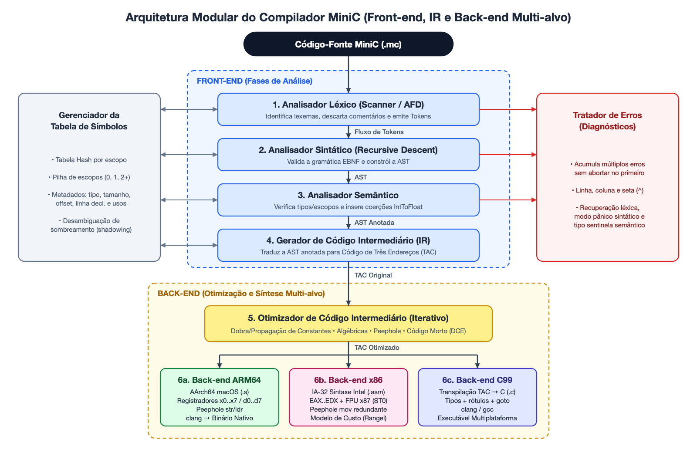

<p align="center">
  
</p>

<h1 align="center">Compilador MiniC</h1>

<p align="center">
  Compilador modular multi-alvo desenvolvido em Python para a disciplina de <strong>Compiladores</strong><br/>
  Instituto Federal Catarinense (IFC) – Campus Rio do Sul
</p>

---

## Recursos da Linguagem

- **Tipos e declarações**: `int`, `float`, `bool`, `string`, `void`, constantes (`const`) e coerção implícita `int → float`.
- **Estruturas de controle**: `if`/`else`, `while`, `for`, `break`, `continue`, `return`, operadores compostos (`+=`, `-=`, `++`, `--`) e curto-circuito em `&&`/`||`.
- **Vetores**: declaração e alocação dinâmica (`int[] v = new int[N]`), indexação `v[i]` e propriedade `v.length`.
- **Orientação a Objetos**: classes (`class`), encapsulamento (`public`/`private`), construtores, instanciação (`new`), referência `this`, `null` e chamada de métodos.
- **Entrada e saída**: `print(...)` e `read(...)`.
- **Gramática formal**: especificada em [docs/GRAMATICA_BNF.md](docs/GRAMATICA_BNF.md).

## Arquitetura (6 Fases)

<p align="center">
  
</p>

1. **Análise Léxica** (`compiler/lexer.py`, `compiler/tokens.py`): *Scanner* manual baseado em Autômato Finito Determinístico (AFD), descarte de comentários (`//` e `/* ... */`), rastreamento de linha/coluna e recuperação de múltiplos erros léxicos.
2. **Análise Sintática** (`compiler/parser.py`, `compiler/ast_nodes.py`): *Parser* *Recursive Descent* (*Top-Down* preditivo) com construção de AST e recuperação de erros em modo pânico.
3. **Análise Semântica e Tabela de Símbolos** (`compiler/semantic.py`, `compiler/symbol_table.py`): Tabela *Hash* com pilha de escopos aninhados, verificação de tipos, controle de acesso (`public`/`private`), desambiguação de sombreamento (*shadowing*) e coerção implícita `int → float` (`IntToFloatExpr`).
4. **Geração de Código Intermediário** (`compiler/ir.py`, `compiler/ir_gen.py`): Linearização da AST em **Código de Três Endereços (TAC)** com temporárias, rótulos e avaliação em curto-circuito.
5. **Otimização de Código** (`compiler/optimizer.py`): Otimizador iterativo até ponto fixo aplicando dobra/propagação de constantes, simplificações algébricas, fusão *peephole* de temporárias e eliminação de código morto (DCE).
6. **Geração de Código Alvo Multi-alvo** (`compiler/codegen/`):
   - **ARM64 (`arm64.py`)**: *Assembly* AArch64 nativo para macOS Apple Silicon (montado e executado com `clang`).
   - **x86 IA-32 (`x86.py`)**: *Assembly* sintaxe Intel didático com FPU x87 (`ST(0)`..`ST(7)`), *peephole* e modelo de custo.
   - **C99 (`c_backend.py`)**: Transpilação TAC → C portável (compilável com `clang`/`gcc`).

## Estrutura do Projeto

```text
.
├── main.py                     # CLI principal do compilador
├── compiler/                   # Fases do compilador (lexer, parser, semantic, IR, optimizer, codegen)
├── examples/                   # Programas de exemplo (.mc), incluindo testes de erros, POO e vetores
├── tests/                      # Suíte de testes automatizados (unittest)
├── vscode-minic/               # Extensão VS Code (syntax highlighting, diagnósticos, autocomplete e execução)
└── docs/                       # Gramática BNF, diagramas e artigo do projeto
```

## Uso pela Linha de Comando (CLI)

Requer **Python 3** (e `clang` ou `gcc` para compilar/executar os binários gerados em ARM64 ou C).

```bash
# Inspecionar todas as 6 fases de uma vez
python3 main.py examples/01_basico.mc --all

# Gerar os 3 alvos (ARM64, x86 e C) na pasta build/ e executar nativamente em ARM64
python3 main.py examples/01_basico.mc --all-targets --run

# Comparar TAC original vs. TAC otimizado com relatório de métricas
python3 main.py examples/06_otimizacao.mc --ir --ir-opt

# Compilar e executar exemplos de POO e vetores
python3 main.py examples/07_orientacao_objetos.mc --all-targets --run
python3 main.py examples/08_vetores_e_controle.mc --all-targets --run

# Compilar e executar via back-end C portável
python3 main.py examples/05_fatorial_e_lacos.mc --target c --run

# Testar detecção e recuperação de múltiplos erros
python3 main.py examples/02_erros_lexicos.mc
python3 main.py examples/03_erros_sintaticos.mc
python3 main.py examples/04_erros_semanticos.mc
```

## Extensão para VS Code (`vscode-minic/`)

O projeto inclui uma extensão para VS Code com:
- Destaque de sintaxe (*syntax highlighting*) e *snippets* para arquivos `.mc`.
- Diagnósticos de erros léxicos, sintáticos e semânticos em tempo real usando o próprio compilador.
- *Autocomplete* para membros de classes (`this.` e `obj.`), *Go to Definition* e *Hover*.
- Botão no editor para compilar e executar o arquivo `.mc` atual no terminal integrado.

Para usar localmente, crie um link simbólico da pasta `vscode-minic` no diretório de extensões do VS Code:

```bash
ln -s "$(pwd)/vscode-minic" ~/.vscode/extensions/minic-language
```

## Testes Automatizados

```bash
python3 -m unittest discover -s tests -v
```

## Documentação

- [Gramática Formal EBNF](docs/GRAMATICA_BNF.md)
- [Artigo do Projeto (INTERUNI 2026)](docs/Artigo_Compilador_MiniC_INTERUNI_2026.docx)
